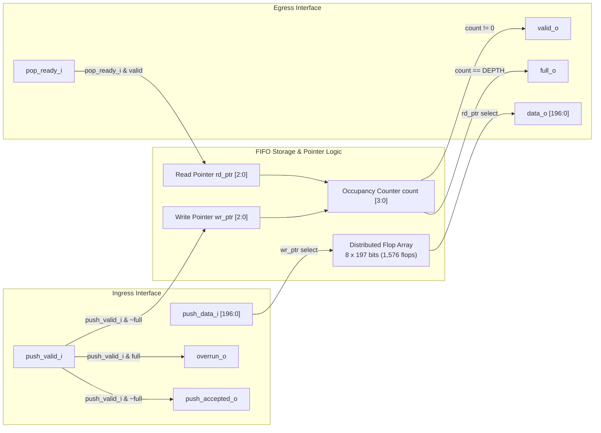

# Micro-Architectural Design Document: Reference Event Ingestion FIFO (`tide_event_fifo.sv`)

**Module Name:** `tide_event_fifo`  
**Source File:** `rtl/tide_event_fifo.sv`  
**Target Architecture:** TIDE EKF Coprocessor Measurement Ingestion / Temporal Front-End  
**Integration Scope:** SCL 180nm CP8D Standard Cell / ASAP7 7nm Predictive PDK  

---

## 1. Executive Purpose & Architectural First Principles

The `tide_event_fifo` module provides a parameterized, cycle-accurate event queuing buffer situated directly at the ingress boundary of the TIDE Temporal Controller (`tide_temporal.sv`). In high-rate autonomous avionics, measurement observations arriving from external sensors (IMU, Barometer, GNSS, Optical Flow, Magnetometer) arrive asynchronously with respect to internal EKF state update cadence. 

Furthermore, delayed measurement packets can arrive out of order (Out-of-Sequence Measurements, OOSM). To prevent head-of-line blocking on the system bus while the VLIW temporal sequencer prepares historical state checkpoints and executes reverse trajectory integration, `tide_event_fifo` serves as the high-bandwidth elastic staging buffer.

### Key Requirements
1. **Zero-Latency Head Readout:** Combinational visibility of the FIFO head (`valid_o`, `data_o`) enables the temporal controller to evaluate arrival timestamps `t_arrival` and event timestamps `t_event` immediately without incurring a multi-cycle synchronous read latency.
2. **Deterministic Backpressure & Non-Blocking Rejection:** If external packet ingestion overflows the maximum buffer depth, the FIFO asserts single-cycle `overrun_o`, rejects the corrupting push, and preserves all previously committed queue states.
3. **Simultaneous Push/Pop Coherency:** Supports concurrent push and pop assertions on identical clock edges without count divergence or memory corruption.
4. **Parameterized Event Width:** Supports packed 197-bit avionics measurement vectors:
   $$\{ \text{flags}[4:0],\, z_3[31:0],\, z_2[31:0],\, z_1[31:0],\, z_0[31:0],\, t_{\text{arrival}}[31:0],\, t_{\text{event}}[31:0] \}$$

---

## 2. Interface Specification & Signal Contracts

| Port Name | Direction | Width | Type | Description |
|:---|:---:|:---:|:---:|:---|
| `clk_i` | Input | 1 | Clock | System clock (500 MHz ASAP7 / 50 MHz SCL 180nm) |
| `rst_ni` | Input | 1 | Reset | Active-low asynchronous reset |
| `push_valid_i` | Input | 1 | Control | Valid indicator from sensor bridge or host CPU |
| `push_data_i` | Input | `WIDTH` (197) | Data | Packed 197-bit measurement event tuple |
| `push_accepted_o` | Output | 1 | Handshake | Acknowledges accepted push (`push_valid_i & ~full_o`) |
| `pop_ready_i` | Input | 1 | Handshake | Pop strobe from `tide_temporal` state machine |
| `valid_o` | Output | 1 | Status | Indicates at least one valid measurement is queued (`count != 0`) |
| `data_o` | Output | `WIDTH` (197) | Data | Combinational readout of current FIFO head (`mem[rd_ptr]`) |
| `full_o` | Output | 1 | Status | Asserted when occupancy equals configured capacity |
| `occupancy_o` | Output | `AW+1` (4) | Metric | Current count of queued entries ($0 \le \text{occupancy} \le 8$) |
| `overrun_o` | Output | 1 | Diagnostic | Single-cycle pulse on push attempt when `full_o == 1'b1` |

---

## 3. Micro-Architectural Implementation & Datapath

### Concurrent Push and Pop State Equations
Let $w_e = \text{push\_valid\_i} \land \neg\text{full\_o}$ and $r_e = \text{valid\_o} \land \text{pop\_ready\_i}$.
The occupancy update is defined as:
$$\text{count}[n+1] = \begin{cases}
\text{count}[n] + 1, & \text{if } w_e \land \neg r_e \\
\text{count}[n] - 1, & \text{if } \neg w_e \land r_e \\
\text{count}[n], & \text{if } (w_e \land r_e) \lor (\neg w_e \land \neg r_e)
\end{cases}$$

---

## 4. Hardware Resource & Physical Layout Considerations

1. **Storage Sizing:** For default `DEPTH = 8` and `WIDTH = 197`, total storage requires 1,576 bits of flip-flops. In SCL 180nm CP8D, standard cell flip-flops (`DFFL11` without asynchronous reset for data bits) occupy approximately $1,576 \times 8 = 12,608\,\mu\text{m}^2$.
2. **Read Port Multiplexing:** Readout `mem[rd_ptr]` requires 197 8-to-1 multiplexers (`MUX81L11` or cascaded `MUX21L11` stages). In ASAP7 7nm FinFET, this evaluates combinationally in $< 65\,\text{ps}$, allowing clean zero-cycle inspection by `tide_temporal.sv`.
3. **Reset Strategy:** Only pointer registers (`wr_ptr`, `rd_ptr`), occupancy counter (`count`), and `overrun_o` are bound to `rst_ni` using `DFCL11` cells. Storage payload flops remain unreset (`DFFL11`) to prevent reset routing grid congestion.
