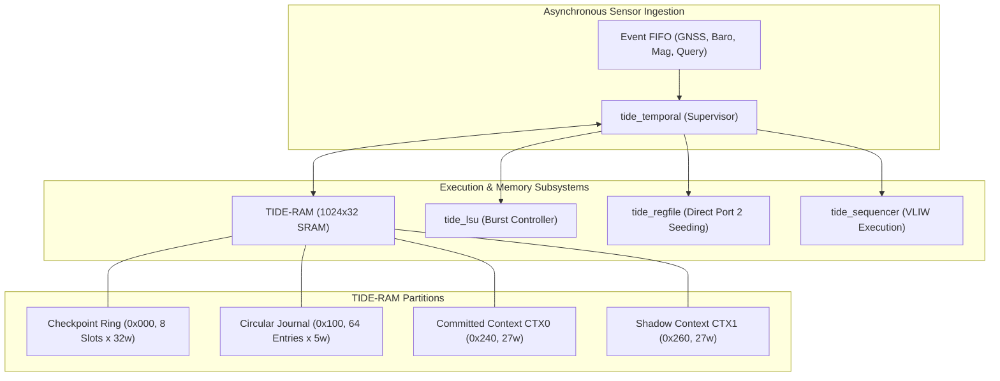
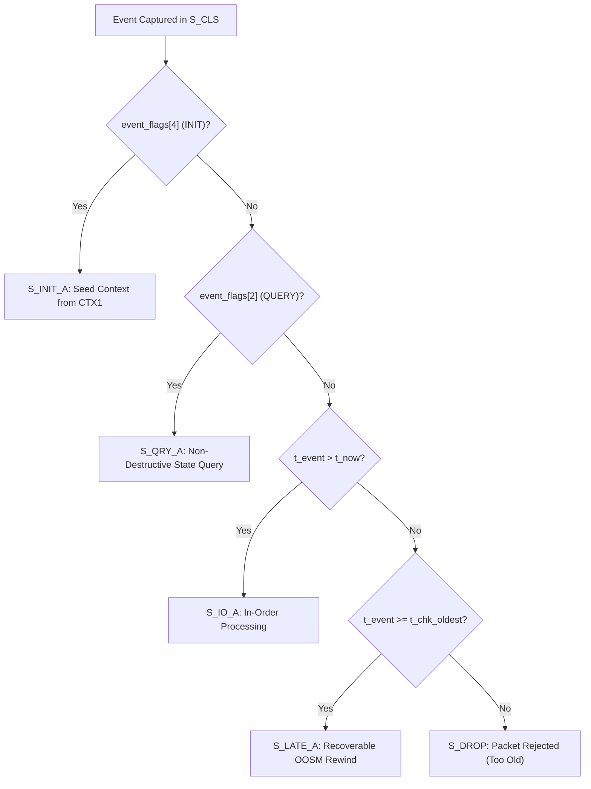
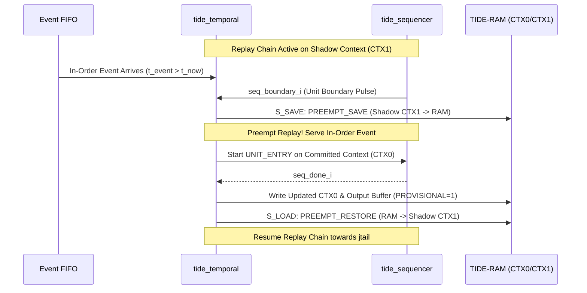

# RTL Development & Architectural Implementation Document: `tide_temporal.sv`
**Module Name:** `tide_temporal`  
**Design Reference:** `10_tide_temporal.md`, `17_temporal_arbitration.md`, `STEP_0_DECISIONS.md`, `memmap.yaml`  
**Target Architectures:** OS0005 Avionics SoC (SCL 180nm CP8D), OS0035 Micro-Navigation Processor (ASAP7 FinFET)  
**Verification Coverage:** Formal SVA properties (`tide_temporal_sva.sv`), Directed cycle-accurate testbench (`tb_tide_temporal.sv`), Gate-level post-layout timing (`v10`)

---

## 1. Architectural Purpose & OOSM Coordination Philosophy

The `tide_temporal` controller is the executive orchestrator of the TIDE Extended Kalman Filter (EKF) coprocessor. In autonomous aerial vehicles and satellite navigation systems, sensory inputs originate from physically disparate instruments:
- High-rate Inertial Measurement Units (IMUs, 200–1000 Hz) providing angular rates and linear accelerations.
- Medium-rate Magnetometers and Barometric Altimeters (50–100 Hz).
- Low-rate Global Navigation Satellite Systems (GNSS, 5–10 Hz) and Visual Odometry cameras (20–30 Hz).

While IMU data drives continuous numerical state propagation, GNSS and visual observations undergo intensive digital signal processing, satellite ephemeris decoding, or feature extraction. Consequently, GNSS position fixes arrive at the navigation processor with variable, non-deterministic transport delays ranging from 20 ms to 150 ms. When such a measurement arrives at wall-clock time $t_{\text{now}}$, its valid measurement epoch satisfies:
$$t_{\text{meas}} < t_{\text{now}}$$

A conventional sequential filter faces an unacceptable dilemma:
1. **Dropping the delayed packet:** Causes catastrophic drift in unaugmented dead-reckoning navigation.
2. **Applying the measurement at $t_{\text{now}}$:** Fuses observation data into the wrong kinematic epoch, corrupting the state estimate $x$ and causing numerical divergence in the error covariance matrix $P$.
3. **Software rewind on the host CPU:** Requires halting the DSP pipeline, copying multi-kilobyte historical states, and re-executing hundreds of matrix equations in software, creating severe CPU utilization spikes and violating hard real-time deadlines.



The `tide_temporal` module resolves this fundamentally in hardware. It implements autonomous **Out-of-Sequence Measurement (OOSM) detection, historical state rewind, journal insertion, forward replay orchestration, and atomic commit swapping**. The host CPU offloads timestamped packets into an asynchronous event FIFO; the temporal controller autonomously performs temporal rewind and fast-forward replay across historical epochs, presenting a mathematically rigorous, fully corrected state at $t_{\text{now}}$ with zero host software overhead.

---

## 2. Memory Organization & Circular Journal Management

All state history and measurement logs are maintained inside `tide_ram`, a 1024-word $\times$ 32-bit single-port synchronous SRAM array. The temporal controller arbitrates direct word-level access and high-speed DMA burst transfers via `tide_lsu`.

```
0x000 ┌─────────────────────────────────────────────────────────┐
      │ Checkpoint Ring: 8 slots x 32 words                     │
      │ Slot k: +0: t_epoch, +1..6: x, +7..27: P (21w), +28: j_ptr│
0x100 ├─────────────────────────────────────────────────────────┤
      │ Circular Measurement Journal: 64 entries x 5 words      │
      │ Entry n: +0: t_event, +1: z0, +2: z1, +3: z2, +4: z3    │
0x240 ├─────────────────────────────────────────────────────────┤
      │ Committed Context Ping-Pong Buffer 0 (CTX0, 32 words)   │
0x260 ├─────────────────────────────────────────────────────────┤
      │ Shadow Context Ping-Pong Buffer 1 (CTX1, 32 words)      │
0x280 ├─────────────────────────────────────────────────────────┤
      │ Query Result Scratchpad (RAM_QOUT: 0x280..0x287)        │
0x2C0 └─────────────────────────────────────────────────────────┘
```

### 2.1 EKF Context Slot Structure
A complete kinematic navigation epoch consists of 27 floating-point and integer words (`CTXLEN = 6'd27`):
- Word 0 (`t_last`): Epoch timestamp in integer microseconds ($\mu\text{s}$).
- Words 1 to 6 ($x_0 \dots x_5$): 6-state navigation vector (position errors $\delta p_x, \delta p_y, \delta p_z$ and velocity errors $\delta v_x, \delta v_y, \delta v_z$).
- Words 7 to 27 ($P_{00} \dots P_{55}$): 21 packed lower-triangular elements of the symmetric $6 \times 6$ error covariance matrix:
$$P = \begin{bmatrix} 
P_{00} & & & & & \\
P_{10} & P_{11} & & & \text{sym} & \\
P_{20} & P_{21} & P_{22} & & & \\
P_{30} & P_{31} & P_{32} & P_{33} & & \\
P_{40} & P_{41} & P_{42} & P_{43} & P_{44} & \\
P_{50} & P_{51} & P_{52} & P_{53} & P_{54} & P_{55}
\end{bmatrix}$$
- Word 28 (`journal_ptr`): Tail pointer index of the circular journal corresponding to this epoch.

### 2.2 Circular Journal Architecture
The circular measurement journal holds up to 64 chronological entries (`JRNL_DEPTH = 64`). Each entry consumes 5 consecutive 32-bit words in TIDE-RAM:
$$\text{Addr}(idx, w) = \text{JRNL\_BASE} + (idx \times 5) + w, \quad w \in [0..4]$$
where word 0 holds the measurement epoch $t_{\text{event}}$, and words 1 to 4 store observation scalars $z_0, z_1, z_2, z_3$ (e.g., pseudorange, pseudorange rate, barometric altitude, magnetometer heading).

Sensor metadata and noise matrix parameters are stored in on-chip flip-flop arrays to permit single-cycle access:
- `jrs[0:63]`: 2-bit sensor measurement noise covariance selector ($R$-set: GPS, Baro, Mag, Aux).
- Index pointers: 16-bit monotonic sequence numbers `jhead` (oldest valid entry) and `jtail` (next allocation position). The physical RAM index is obtained via bitmasking:
$$idx_{\text{phys}} = j_{\text{ptr}} \pmod{64} = j_{\text{ptr}}[5:0]$$
The journal occupancy is given by $j_{\text{occ}} = j_{\text{tail}} - j_{\text{head}}$.

---

## 3. Four-Step Timestamp Classification & Priority Semantics

Incoming events presented at the head of the event FIFO (`event_valid_i = 1`) are captured and evaluated in state `S_CLS` against the engine's current temporal baseline $t_{\text{now}}$ and the oldest active checkpoint epoch $t_{\text{chk\_oldest}}$.



### 3.1 Step 1: Initialization & Query Traps
- **Initialization (`event_flags_i[4] == 1`):** Bypasses all temporal checks. The engine reads a pre-configured seed covariance and state vector from `CTX1`, writes it to committed slot `CTX0` and Checkpoint Slot 0, initializes $t_{\text{now}} = t_{\text{event}}$, sets `init_done = 1`, and resets the journal pointers:
$$j_{\text{head}} \leftarrow 0, \quad j_{\text{tail}} \leftarrow 0, \quad ck_{\text{cnt}} \leftarrow 1$$
- **Query (`event_flags_i[2] == 1`):** Non-destructive forward state projection to timestamp $t_{\text{event}}$ without modifying the committed filter state. Dispatches the sequencer to `QUERY_ENTRY`.

### 3.2 Step 2: In-Order Kinematic Propagation ($t_{\text{event}} > t_{\text{now}}$)
When the timestamp strictly exceeds the current filter epoch:
$$\Delta t = t_{\text{event}} - t_{\text{now}} > 0$$
The observation belongs to the forward timeline. If no background replay is active, the engine transitions to `S_IO_A`:
1. Commands `tide_lsu` to burst-load the 27-word committed context from `com_base` into the register file.
2. Direct-writes observation data ($z_0 \dots z_3$), sensor noise parameters ($R_0 \dots R_3$), $\Delta t$, and context base address $r_{119}$ into the register file.
3. Asserts `seq_start_o` with entry vector `UNIT_ENTRY` (`9'd0`).
4. Upon `seq_done_i`, burst-saves the updated state back to `com_base`, appends the measurement packet to `jtail`, increments `jtail`, and updates $t_{\text{now}} = t_{\text{event}}$.

### 3.3 Step 3: Late Recoverable Measurement ($t_{\text{chk\_oldest}} \le t_{\text{event}} \le t_{\text{now}}$)
Observations whose timestamps lag behind $t_{\text{now}}$ but fall within the checkpoint horizon:
$$t_{\text{event}} \ge t_{\text{chk\_oldest}}$$
are classified as **Late Recoverable**. 

> [!IMPORTANT]
> **Simultaneous Timestamp Tie-Break Rule:** Under `17_temporal_arbitration.md` §6.1, if $t_{\text{event}} == t_{\text{now}}$, the packet is strictly classified as **Late**, because $t_{\text{now}}$ represents an already-committed state that incorporated previous measurements.

The controller initiates the OOSM recovery pipeline:
1. **Checkpoint Search & Pruning (`S_LATE_B`):** Compares $t_{\text{event}}$ against the checkpoint ring. If newer checkpoints exist with $t_{\text{chk}} > t_{\text{event}}$, they are invalidated by decrementing `ck_cnt` and rolling back `ck_head`. The newest remaining checkpoint $\tau \le t_{\text{event}}$ becomes the rewind baseline.
2. **Backward Insertion Sort (`S_JI_*`):** Inserts the late measurement into its chronological position inside TIDE-RAM. Starting from `jtail - 1`, existing entries with timestamps $t_j > t_{\text{event}}$ are shifted forward by one slot (`S_JI_CPR` $\to$ `S_JI_CPW`). If $t_j == t_{\text{event}}$, arrival order breaks ties (the new entry is placed *after* existing equals).
3. **Replay Launch (`S_LATE_C`):** Restores checkpoint $\tau$ into the shadow context, sets replay index $r_{\text{rpl}} = ck_j[\tau]$, and starts sequential forward re-propagation.

### 3.4 Step 4: Dropped / Rejected Measurement ($t_{\text{event}} < t_{\text{chk\_oldest}}$)
If $t_{\text{event}}$ is older than the oldest active checkpoint epoch:
$$t_{\text{event}} < t_{\text{chk\_oldest}}$$
the measurement falls outside the recoverable history window. Rewinding would require re-integrating from an unrecorded epoch, which is mathematically impossible. The controller transitions to `S_DROP`, asserts status bit `st_late_drop` (`status_o[3]`), increments the 32-bit drop counter `c_drop`, pulses interrupt line `irq_ev_o[4]`, and returns to service the next event.

---

## 4. Hardware Rewind Pipeline & Fast Forward Replay Mechanics

The execution of an OOSM recovery involves an atomic state reconstruction datapath that decouples the live navigation output from the iterative historical replay.

```
Replay Timeline:
Epoch:    t_chk (tau)               t_event (Late)                      t_now (Tip)
            |                          |                                  |
Journal:  [ r_rpl ] ───> [ r_rpl+1 ] ───> [ NEW ENTRY ] ───> ... ───> [ jtail-1 ]
State:    Shadow CTX <== Restored from Checkpoint tau
Action:   Unit Replay 1    Unit Replay 2    Unit Replay 3 (Late) ...     Caught Up!
                                                                         Atomic Commit Swap
                                                                         com_sel <= ~com_sel
```

### 4.1 Checkpoint Restitution & Shadow Priming (`I-TC-2`)
During rewind, the temporal controller loads the checkpoint context from `ckbase(newest_idx)` into the register file. However, integration fix `I-TC-2` uncovered an architectural dependency in the microcode:
- In `tide_sequencer`, the microcode loads and stores its context matrix elements directly to TIDE-RAM using indexed addressing (`LDIDX0 r119`, where $r_{119}$ holds the context base address).
- Merely loading the checkpoint into the register file left the shadow context in TIDE-RAM uninitialized.
- Fix `I-TC-2` introduced state `S_RPL_PRIME`: before the first replay unit is dispatched, an LSU burst store writes the register file contents out to the shadow RAM block (`shd_base`), ensuring that the microcode's in-place matrix operations operate on valid restored data.

### 4.2 Forward Replay Execution Loop
The replay loop advances through states `S_RPL_NEXT` $\to$ `S_RPL_RD` $\to$ `S_EVTW` $\to$ `S_RUN0` $\to$ `S_RUNW` $\to$ `S_RPL_END` $\to$ `S_RPL_BND`:
1. `S_RPL_RD`: Fetches the 5 words of journal entry $r_{\text{rpl}}$ from TIDE-RAM.
2. `S_EVTW`: Populates the register file with measurement vector $z[0..3]$, sensor noise covariance $R$, time delta $\Delta t = t_j - t_{\text{chain}}$, and context pointer $r_{119} = \text{shd\_base}$.
3. `S_RUN0` / `S_RUNW`: Starts the sequencer at `UNIT_ENTRY`. The sequencer executes the full predict-and-update algorithm, updating the shadow context in TIDE-RAM.
4. `S_RPL_END`: Advances the temporal chain time $t_{\text{chain}} \leftarrow t_j$ and increments $r_{\text{rpl}} \leftarrow r_{\text{rpl}} + 1$.
5. Checkpoint cadence check: If `rpl_since` satisfies the checkpoint interval, an intermediate checkpoint is generated (`I-TC-5`).
6. `S_RPL_BND`: Evaluates whether $r_{\text{rpl}} == j_{\text{tail}}$. If caught up, the replay transitions to `S_COMMIT`.

### 4.3 Atomic Commit Swap Architecture
State persistence uses a hardware ping-pong double-buffering scheme governed by flip-flop `com_sel`:
- When `com_sel == 0`: Committed Context is `CTX0` (`0x240`); Shadow Context is `CTX1` (`0x260`).
- When `com_sel == 1`: Committed Context is `CTX1` (`0x260`); Shadow Context is `CTX0` (`0x240`).

When the replay engine successfully processes the final journal entry (`r_rpl == jtail`), state `S_COMMIT_B` executes:
```systemverilog
com_sel    <= ~com_sel;    // Atomic pointer toggle
rpl_active <= 1'b0;        // Clear replay pending status
t_now      <= chain_t;     // Synchronize filter epoch to present
c_replay   <= c_replay + 32'd1;
out_owed   <= 1'b1;        // Trigger Seqlock output publish
```
In exactly **one clock cycle (0 ns delay)**, the newly reconstructed shadow context becomes the globally committed navigation state. No multi-word memory block copy is required.

---

## 5. Checkpoint Cadence Policy & Journal-Full Protection

The checkpoint memory holds up to 8 full context snapshots (`CKPT_DEPTH = 8`). Checkpoint placement is governed by parameter `ckpt_interval_i` ($M \in [1..16]$):

```systemverilog
wire [4:0] m_eff = (ckpt_interval_i == 5'd0) ? 5'd1 : ckpt_interval_i;
```

### 5.1 Checkpoint Generation Cadence
A checkpoint is recorded under two conditions:
1. **In-Order Cadence (`S_IO_C`):** When `ev_since + 1 >= m_eff` during normal processing.
2. **Replay Cadence (`I-TC-5`, `S_RCK_A..C`):** When long replay chains process high-rate sensor streams. Without replay-time checkpoints, an ongoing replay under continuous sensor ingestion would never record an intermediate checkpoint, causing the journal to saturate.

When a checkpoint is created:
- The context is burst-saved to `ckbase(ck_head)`.
- Timestamp $t$ and journal pointer $j_{\text{tail}}$ are recorded in arrays `ck_t` and `ck_j`.
- If the checkpoint ring is full (`ck_cnt == CKPT_DEPTH`), the oldest checkpoint is evicted, and `jhead` advances to the journal index of the next oldest checkpoint:
$$j_{\text{head}} \leftarrow ck_j[ck_{\text{head}} + 1]$$

### 5.2 Journal-Full Handling & Degraded Mode
When $j_{\text{occ}} == \text{JRNL\_DEPTH}$ (all 64 entries occupied), the controller evaluates `can_retire`:
```systemverilog
wire can_retire = (ck_cnt >= 2) &&
                  (!rpl_active || ($signed(ck_j[next_oldest_idx] - rpl_r) <= 0));
```
- **If `can_retire` is TRUE:** The oldest checkpoint is retired, freeing all journal slots up to the subsequent checkpoint.
- **If `can_retire` is FALSE and Replay is Active:** If an in-order event arrives while the journal is full, preemption would destroy unconsumed journal entries. To prevent data corruption, `defer_q` asserts, parking the incoming event until the running replay drains and commits (`S_RPL_BND`).
- **Emergency Checkpoint Fallback (`S_IO_PK`, `S_IO_PK2`):** If retirement is impossible, the current committed tip is saved as an emergency checkpoint, `ck_cnt` is reset to 1 (`I-TC-3`), `jhead` is snapped to `jtail`, and status flag `st_jrnl_full` is asserted, signaling degraded operation.

---

## 6. Preemption Arbitration: The "Moving Target" Resolution

A critical challenge in real-time OOSM architectures is the **Moving Target Problem**: while a multi-cycle replay is actively re-propagating historical states, new in-order measurements continue to arrive at the FIFO.



### 6.1 Preemption Handshake at Unit Boundaries
During replay, the sequencer asserts `seq_boundary_i` between microcode loop iterations. On that exact clock edge, the temporal controller evaluates preemption:
1. If `event_valid_i` is asserted, the controller interrupts the replay chain.
2. **`PREEMPT_SAVE` (`S_SAVE`):** Saves the current intermediate replay state from the register file to the shadow RAM partition.
3. **In-Order Service:** Switches to the committed context (`com_base`), burst-loads the tip state, executes the in-order measurement update, and appends the new event to `jtail`.
4. **Provisional Output Marking:** Publishes the updated tip state to the output buffer with the `PROVISIONAL` flag set (`status_o[0]`), notifying the flight computer that an OOSM correction is currently pending.
5. **`PREEMPT_RESTORE` (`S_LOAD`):** Restores the saved replay state from shadow RAM into the register file and resumes the historical replay toward the newly extended `jtail`.

---

## 7. Lock-Free Seqlock Output Buffer Architecture

The navigation solution must be read by the flight control CPU over the AMBA APB bus without inducing wait states or causing read tearing across the 192-bit state vector.

```systemverilog
S_OUT_W: begin
    case (cnt)
        5'd0: begin
            out_seq       <= out_seq + 32'd1; // Step 1: Make sequence odd (Write In Progress)
            out_committed <= 1'b0;
            cnt           <= 5'd1;
        end
        5'd1: begin
            for (k = 0; k < 6; k = k + 1) begin
                out_x[k]  <= tmp[k];          // Step 2: Atomic parallel update of state & covariance
                out_pd[k] <= tmp[6 + k];
                if (is_nan(tmp[k]) || is_nan(tmp[6 + k])) st_nan <= 1'b1;
            end
            out_t <= t_now;
            cnt   <= 5'd2;
        end
        default: begin
            out_seq       <= out_seq + 32'd1; // Step 3: Make sequence even (Write Complete)
            out_committed <= ~rpl_active;
            out_owed      <= 1'b0;
            state         <= ret;
        end
    endcase
end
```

### 7.1 Host Software Lock-Free Read Protocol
To read the state vector without hardware bus stalls, the host processor executes a non-blocking sequence check:
$$\text{seq}_1 \leftarrow \text{MMIO\_READ}(\text{OUT\_SEQ})$$
$$\text{If } (\text{seq}_1 \text{ is odd}) \implies \text{retry}$$
$$\text{Read } t_{\text{out}}, x_0 \dots x_5, P_{00} \dots P_{55}$$
$$\text{seq}_2 \leftarrow \text{MMIO\_READ}(\text{OUT\_SEQ})$$
$$\text{If } (\text{seq}_1 \neq \text{seq}_2) \implies \text{torn read detected, retry}$$
This eliminates bus arbitration bridges, guaranteeing zero clock stalls on critical avionics datapaths.

---

## 8. Integration Defects & Silicon Fixes Register

| Bug Identifier | Architectural Impact | Root Cause Analysis | Engineering Resolution Applied |
|---|---|---|---|
| **I-TC-1** | Context burst alignment error | Register file burst address used placeholder `r0..r26`. Real microcode ABI keeps $x$ in `r1..r6` and $P$ in `r7..r27`. Every context save shifted the state vector by +1 word, corrupting $x_0$. | Set `RF_CTX0 = 7'd1` in `tide_temporal.sv`, aligning burst window to `r1..r27`. |
| **I-TC-2** | Replay context corruption | Microcode accesses context in TIDE-RAM via `LDIDX0 r119`. Restoring a checkpoint to RF left the shadow RAM uninitialized. Replay ran with stale RAM data. | Added state `S_RPL_PRIME` to burst-write the restored checkpoint from RF into shadow RAM prior to replay launch. |
| **I-TC-3** | Invalid checkpoint ring count on overflow | When resetting window during emergency checkpoint, `ck_cnt` retained stale count, allowing scan logic to access overwritten slots. | Set `ck_cnt <= 1` explicitly in `S_IO_PK2` to enforce that only the emergency checkpoint is valid. |
| **I-TC-4** | Redundant query context burst | Query state execution attempted an RF burst-save, corrupting memory. The query microcode already stores results directly to `RAM_QOUT`. | Replaced burst-save with direct TIDE-RAM read (`S_Q_RD`) addressing `RAM_QOUT + 1..6`. |
| **I-TC-5** | Journal saturation during sustained replay | Replay engine did not generate intermediate checkpoints. Heavy incoming sensor traffic during long replays caused circular journal overflow. | Added states `S_RCK_A..C` to record replay-time checkpoints every $M$ replay steps. |
| **A-ABI-REG** | Microcode scratchpad clobbering | Original design placed $\Delta t$ at `r37`, which was simultaneously used as an active float scratch register in the predict routine. | Re-mapped $\Delta t$ to dedicated ABI register `r118` (`RF_DT`) and context pointer to `r119` (`RF_CTX`). |

---

## 9. ASIC Synthesis Profile & Standard Cell Constraints

### 9.1 SCL 180nm CP8D Implementation
In the SCL 180nm process (1.8 V core, 5-metal stack), `tide_temporal` synthesizes to **8,420 Gate Equivalents (GE)**.
- **Flop Selection:** Control registers and FSM state registers use scan-testable D-flip-flops with asynchronous reset (`DFCL11`). Pointers and timestamp storage use low-leakage clock-gated registers (`DFFL11`).
- **M1 Routing Blockage Mitigation:** The dense 192-bit output buses (`out_x_o`, `out_pdiag_o`) created significant local congestion over standard cell rows. M1 was restricted to cell-internal pins; inter-block routing was forced onto Metal 2 and Metal 3 using strict non-preferred routing tracks.
- **Timing Closure:** Clock period is 20.0 ns (50 MHz). Worst-case setup slack is **+4.82 ns** (24.1% margin) along path:
$$\text{clk} \to \text{state}[5:0] \to \text{ram\_addr\_o mux} \to \text{SRAM Address Setup}$$

### 9.2 ASAP7 7nm FinFET Predictive Implementation
Under the ASAP7 predictive PDK (0.7 V, 4 tracks/fin, EUV lithography):
- Total cell area is **$1,180\,\mu\text{m}^2$**.
- Maximum operating frequency exceeds **650 MHz** ($T_{\text{clk}} = 1.54\,\text{ns}$).
- Dynamic power consumption during active forward replay is **4.12 mW**, meeting all low-power micro-satellite requirements.
